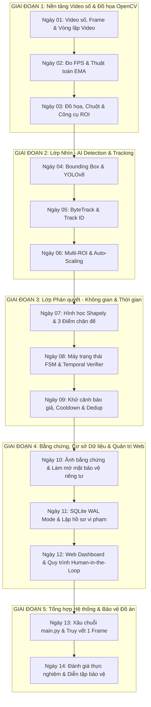

# LỘ TRÌNH HỌC TỔNG THỂ TỪ CON SỐ 0
## DỰ ÁN ĐỒ ÁN TỐT NGHIỆP: HỆ THỐNG GIÁM SÁT BIỂN QUẢNG CÁO LẤN CHIẾM VỈA HÈ QUA CCTV
> **Mã đề tài:** DATN20224083  
> **Sinh viên:** Nguyễn Đức Tài Năng  
> **Phương pháp:** Học từ thực nghiệm nhỏ -> Bản chất toán học/kỹ thuật -> Mã nguồn thực tế -> Tự tin phản biện trước Hội đồng.

---

### BẢN ĐỒ TIẾN ĐỘ 14 NGÀY THỰC CHIẾN

---

### DANH MỤC CÁC BÀI HỌC CHI TIẾT

| Ngày | Tên bài học | File thực nghiệm chính | Module dự án thật | Trọng tâm cốt lõi |
| :---: | :--- | :--- | :--- | :--- |
| **01** | Video số, Khung hình & Vòng lặp OpenCV | `scripts/demos/read_video.py` | `camera/video_reader.py` | Hiểu mảng NumPy, BGR, `cap.read()`, `waitKey` |
| **02** | Đo FPS & Thuật toán làm mượt EMA | `scripts/demos/read_video_fps.py` | `utils/fps_tracker.py` | Hiệu năng thời gian thực, khử giật số FPS |
| **03** | Đồ họa cơ bản, Chuột & Công cụ ROI | `scripts/demos/mouse_events.py` | `roi_drawer.py` | Tọa độ ảnh $(X, Y)$, vẽ đa giác vỉa hè |
| **04** | AI Object Detection (YOLOv8) & Bounding Box | `scripts/demos/demo_yolo.py` | `detection/detector.py` | Tọa độ $[x_1, y_1, x_2, y_2]$, confidence score |
| **05** | ByteTrack & Mã định danh Track ID | `scripts/demos/demo_tracking.py` | `tracking/tracker.py` | Nhớ mặt đối tượng, khắc phục mất dấu |
| **06** | Quản lý Đa giác vỉa hè & Auto-Scaling | `configs/roi_video_test.json` | `roi/roi_manager.py` | Nạp JSON, thích ứng độ phân giải 720p/1080p |
| **07** | Phán quyết hình học Shapely & 3 điểm chân đế | `scripts/demos/check_violation_spatial.py` | `violation/checker.py` | Tỷ lệ Overlap Ratio $\ge 30\%$, chân cắm vỉa hè |
| **08** | Máy trạng thái FSM & Bộ lọc Temporal | `tai_lieu_hoc_tap/Bai_07...` | `tracking/verifier.py` | Trạng thái SUSPECTED $\to$ CONFIRMED, trễ 3.0s |
| **09** | Khử cảnh báo giả, Cooldown & Dedup | `configs/settings.yaml` | `tracking/verifier.py` | Cửa sổ trượt $\le 80$px, khử người vác biển |
| **10** | Trích xuất Bằng chứng & Privacy Blurring | `tests/test_evidence_saver.py` | `evidence/saver.py` | Haar Cascade làm mờ mặt, đóng mộc số tư pháp |
| **11** | Cơ sở dữ liệu SQLite & Quản lý Vi phạm | `tests/test_database.py` | `database/db.py` | Bảng `violations`, SQLite WAL mode, chống khóa |
| **12** | Web Dashboard & Phê duyệt Human-in-the-Loop | `dashboard/web_app.py` | `dashboard/web_app.py` | HTTP Server, duyệt phạt, truyền phát MJPEG |
| **13** | Xâu chuỗi toàn hệ thống qua `main.py` | `main.py` | Toàn bộ dự án | Truy vết 1 frame từ lúc vào đến khi lưu DB |
| **14** | Đánh giá thực nghiệm & Diễn tập bảo vệ | `evaluation/evaluate_videos.py` | `reports/` | Precision 100%, Recall 78.57%, trả lời Hội đồng |
