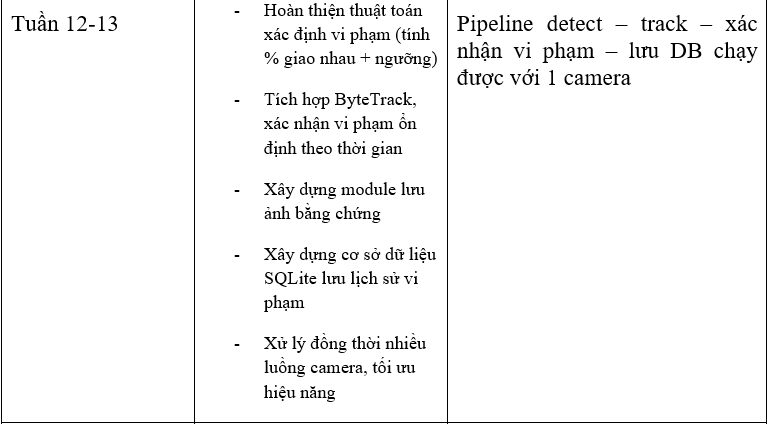
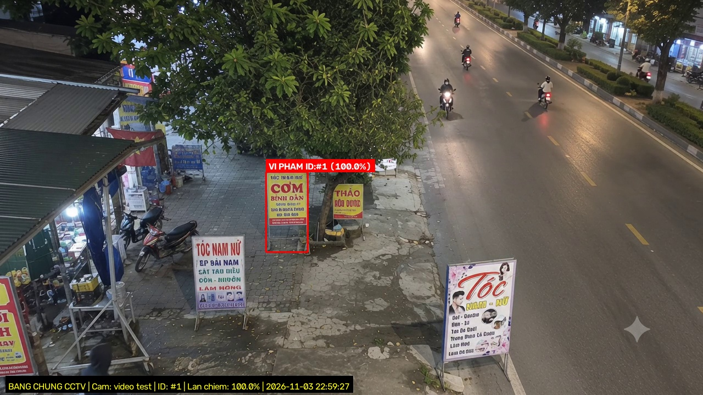

# BÁO CÁO TIẾN ĐỘ ĐỒ ÁN TỐT NGHIỆP TUẦN 12–13
## HOÀN THIỆN PIPELINE PHÁT HIỆN, THEO DÕI, XÁC NHẬN VI PHẠM VÀ QUẢN LÝ DỮ LIỆU CCTV

---

* **Đơn vị đào tạo:** Đại học Bách Khoa Hà Nội — Trường Công nghệ Thông tin và Truyền thông
* **Tên đề tài:** Nghiên cứu và xây dựng hệ thống phát hiện biển hiệu, biển quảng cáo lấn chiếm vỉa hè qua camera giám sát CCTV cố định
* **Sinh viên thực hiện:** Nguyễn Đức Tài Năng — MSSV: **20224083** — Lớp: Kỹ thuật Máy tính K67
* **Giảng viên hướng dẫn:** Thầy/Cô Cán bộ Hướng dẫn ĐATN
* **Thời gian thực hiện:** Giai đoạn Tuần 12 – Tuần 13 theo biểu đồ tiến độ 17 tuần của Đề cương ĐATN
* **Trạng thái tài liệu:** Báo cáo tiến độ chính thức kèm mã nguồn, nhật ký kiểm thử và hồ sơ bằng chứng

---

## TỔNG QUAN TIẾN ĐỘ TUẦN 12–13 VÀ TIÊU CHÍ ĐỐI CHIẾU ĐỀ CƯƠNG

### 1. Tiêu chí đối chiếu theo Đề cương ĐATN chính thức

Theo kế hoạch tiến độ 17 tuần của Đề cương ĐATN được phê duyệt, giai đoạn **Tuần 12–13** đặt ra 5 hạng mục công việc trọng tâm và 1 tiêu chí sản phẩm nghiệm thu cốt lõi:


*Hình 1. Trích lục nội dung kế hoạch và tiêu chí nghiệm thu Tuần 12–13 từ Đề cương ĐATN chính thức*

*Nguyên tắc liêm chính học thuật:* Nội dung trong biểu đồ kế hoạch trên được dùng làm **thước đo đối chiếu (benchmark baseline)**, hoàn toàn không được tự coi là bằng chứng đã hoàn thành nếu chưa có mã nguồn, cấu hình, dữ liệu kiểm thử và nhật ký thực thi độc lập chứng minh.

### 2. Tiêu chí sản phẩm nghiệm thu cốt lõi
* **Yêu cầu đề cương:** *"Pipeline detect – track – xác nhận vi phạm – lưu DB chạy được với 1 camera"*.
* **Yêu cầu đối với hệ thống đa camera:** Khảo sát, thiết kế và tối ưu khả năng xử lý đồng thời nhiều luồng camera; phân định rạch ròi giữa việc đã chạy được trên 1 camera thực tế với việc chạy đồng thời nhiều camera.

---

## BẢNG ĐỐI CHIẾU TIẾN ĐỘ 5 HẠNG MỤC CÔNG VIỆC TUẦN 12–13

Dưới đây là bảng tổng hợp kết quả rà soát chi tiết 5 hạng mục công việc theo Đề cương, đối chiếu trực tiếp với mã nguồn, bộ kiểm thử tự động (unit tests) và nhật ký thực nghiệm trong workspace:

| STT | Hạng mục công việc (Theo Đề cương) | Nội dung kỹ thuật & Tiêu chí cần đạt | Trạng thái thực tế | Tệp mã nguồn, Cấu hình & Bằng chứng Log | Tồn tại kỹ thuật & Việc còn lại |
|:---:|:---|:---|:---:|:---|:---|
| **1** | **Hoàn thiện thuật toán xác định vi phạm** | Tính % diện tích giao nhau 2D (Overlap Ratio) giữa bounding box biển hiệu và đa giác vỉa hè; so sánh với ngưỡng threshold; kiểm tra điểm tiếp đất. | <span style="color:#10b981; font-weight:bold;">HOÀN THÀNH</span> | • [`violation/checker.py`](file:///c:/Users/Admin/Downloads/DATN20224083/violation/checker.py): Thuật toán lai kép (Dual-Condition Logic) kết hợp kiểm tra 3 điểm tiếp đất `pt_left`, `pt_center`, `pt_right` bằng `cv2.pointPolygonTest` và diện tích giao cắt 2D Shapely Polygon.<br>• Ngưỡng vi phạm: `threshold=0.30` (30%).<br>• [`tests/test_violation_checker.py`](file:///c:/Users/Admin/Downloads/DATN20224083/tests/test_violation_checker.py): Đạt 4/4 kịch bản (100%). | Bounding box 2D hình chữ nhật bị phình to diện tích khi biển đặt chéo góc máy camera; giai đoạn sau có thể nâng cấp sang mặt nạ phân đoạn phiên bản (Instance Segmentation Mask) để tăng độ khít hình học. |
| **2** | **Tích hợp ByteTrack & Xác nhận ổn định theo thời gian** | Gán và duy trì mã định danh ID qua các khung hình; áp dụng bộ lọc chuỗi thời gian để loại trừ 100% cảnh báo giả do người mang biển đi qua hoặc bóng đổ thoáng qua. | <span style="color:#10b981; font-weight:bold;">HOÀN THÀNH</span> | • [`tracking/tracker.py`](file:///c:/Users/Admin/Downloads/DATN20224083/tracking/tracker.py): Bộ bám vết ByteTrack với cấu hình tối ưu [`configs/bytetrack_custom.yaml`](file:///c:/Users/Admin/Downloads/DATN20224083/configs/bytetrack_custom.yaml) (`track_high_thresh=0.25`, `track_low_thresh=0.10`).<br>• [`tracking/verifier.py`](file:///c:/Users/Admin/Downloads/DATN20224083/tracking/verifier.py): Máy trạng thái `NORMAL` $\to$ `SUSPECTED` $\to$ `CONFIRMED`. Cửa sổ thời gian 3.0s (`confirm_seconds=3.0`), kiểm soát độ đứng yên liên tục (`require_stationary=True`).<br>• [`tests/test_temporal_verifier.py`](file:///c:/Users/Admin/Downloads/DATN20224083/tests/test_temporal_verifier.py): Đạt 7/7 kịch bản (100%). | Khi camera bị rung lắc mạnh do gió bão hoặc phương tiện siêu trường chạy qua làm rung cột CCTV, cần tích hợp thêm thuật toán bù trừ rung lắc toàn khung hình (Global Motion Compensation - GMC). |
| **3** | **Xây dựng module lưu ảnh bằng chứng** | Tự động chụp và lưu trữ hình ảnh hiện trường vi phạm, phục vụ công tác thanh tra đô thị và xử phạt nguội; tổ chức cây thư mục chuẩn. | <span style="color:#10b981; font-weight:bold;">HOÀN THÀNH</span> | • [`evidence/saver.py`](file:///c:/Users/Admin/Downloads/DATN20224083/evidence/saver.py): Lưu đồng thời 2 cấp độ ảnh: Ảnh toàn cảnh (Full Frame) đóng tem pháp lý (thời gian, camera, tọa độ, % lấn chiếm) và ảnh cận cảnh (Cropped Image) phóng to biển hiệu.<br>• Phân cấp thư mục: `evidence/records/<cam>/<YYYY-MM-DD>/` và `evidence/crops/...`.<br>• [`tests/test_evidence_saver.py`](file:///c:/Users/Admin/Downloads/DATN20224083/tests/test_evidence_saver.py): Đạt 100%.<br>• Cơ chế `_safe_imwrite` bảo vệ chống lỗi đường dẫn Unicode tiếng Việt trên Windows. | Tính năng làm mờ khuôn mặt (Privacy Face Blur) hiện phụ thuộc tệp Haar cascade OpenCV ngoài; việc ghi đĩa hiện chạy đồng bộ (synchronous), cần chuyển sang hàng đợi nền bất đồng bộ (async worker) để tránh làm trễ FPS khi lưu nhiều ảnh. |
| **4** | **Cơ sở dữ liệu SQLite lưu lịch sử vi phạm** | Xây dựng CSDL quan hệ lưu trữ hồ sơ vi phạm, hỗ trợ quy trình phê duyệt phạt nguội Human-in-the-Loop (Chờ duyệt, Xác nhận, Bác bỏ, Đã xử phạt). | <span style="color:#10b981; font-weight:bold;">HOÀN THÀNH</span> | • [`database/db.py`](file:///c:/Users/Admin/Downloads/DATN20224083/database/db.py): Quản trị CSDL SQLite [`data/surveillance.db`](file:///c:/Users/Admin/Downloads/DATN20224083/data/surveillance.db).<br>• Bảng `violations` với 19 trường dữ liệu chuẩn hóa.<br>• Thuật toán khử trùng lặp `is_duplicate_violation` phân định theo ca trực ngày mới.<br>• Các hàm nghiệp vụ: `insert_violation`, `update_violation_status`, `get_statistics`, `get_available_dates`.<br>• [`tests/test_database.py`](file:///c:/Users/Admin/Downloads/DATN20224083/tests/test_database.py): Đạt 100%.<br>• CSDL hiện lưu giữ **257 hồ sơ thực tế** (18 hồ sơ mới ngày 03/11/2026). | Chưa có cơ chế mã hóa dữ liệu nhạy cảm ở mức tệp (file-level encryption) và quy trình tự động dọn dẹp/lưu trữ dữ liệu cũ (auto-retention / purge) sau 90 ngày theo quy định pháp lý. |
| **5** | **Xử lý đồng thời nhiều luồng camera & Hiệu năng** | Xử lý song song nhiều luồng camera CCTV (RTSP/Webcam/Video); tối ưu hóa tài nguyên phần cứng (FPS, Latency, Throughput). | <span style="color:#eab308; font-weight:bold;">MỘT PHẦN (PARTIAL)</span><br>*(Đa luồng đồng thời: Chưa kiểm chứng)* | • [`camera/stream_reader.py`](file:///c:/Users/Admin/Downloads/DATN20224083/camera/stream_reader.py): Cơ chế đọc luồng nền `threading.Thread` độc lập cho từng camera để xả bộ đệm (Zero Latency Buffer Flush) và tự động kết nối lại (Auto-reconnect).<br>• [`dashboard/web_app.py`](file:///c:/Users/Admin/Downloads/DATN20224083/dashboard/web_app.py): Sử dụng `ThreadingHTTPServer` phục vụ đồng thời các kết nối xem camera.<br>• **Đã đo đạc thực nghiệm trên 1 camera:** CPU i5 đạt 22.2 FPS (PyTorch) và 31.3 – 39.2 FPS (ONNX Runtime); GPU Tesla T4 đạt 58.5 FPS (1280x1280).<br>• **CHƯA KIỂM CHỨNG ĐỒNG THỜI:** Trong mã nguồn dòng lệnh `main.py`, hệ thống hiện chạy cho 1 camera tại một thời điểm, chưa có bộ điều phối chạy song song $\ge 4$ luồng camera đồng thời trên cùng luồng suy luận AI. Chưa có số liệu benchmark tải CPU/VRAM khi nạp đồng thời nhiều camera. | Cần xây dựng module Multi-Camera Ingestion Manager (mỗi camera 1 process/thread riêng biệt với hàng đợi Queue chung) và đo đạc độ trễ/sụt giảm FPS khi tải đồng thời 2, 4, 8 camera. |

---

## PHẦN 1: RÀ SOÁT CHI TIẾT TỪNG HẠNG MỤC KỸ THUẬT

### 1. Thuật toán xác định vi phạm không gian (Spatial Logic & Overlap Ratio)
Module [`violation/checker.py`](file:///c:/Users/Admin/Downloads/DATN20224083/violation/checker.py) đóng vai trò là "bộ não phán quyết không gian" của hệ thống, chuyển đổi kết quả phát hiện vật thể dạng Bounding Box sang kết luận pháp lý về hành vi lấn chiếm vỉa hè.

#### Cơ chế hoạt động của thuật toán lai kép (Dual-Condition Engine):
1. **Điều kiện 1 — Tọa độ chân đế tiếp xúc mặt đất (3-Point Ground Contact Rule):**
   * Biển hiệu quảng cáo đứng trên vỉa hè có bản chất vật lý là chân đế phải chạm mặt đất.
   * Thuật toán trích xuất 3 điểm tại cạnh đáy hộp bao:
     $$\text{pt}_{\text{left}} = (x_1, y_2), \quad \text{pt}_{\text{center}} = \left(\frac{x_1 + x_2}{2}, y_2\right), \quad \text{pt}_{\text{right}} = (x_2, y_2)$$
   * Sử dụng hàm `cv2.pointPolygonTest` với dung sai tiếp đất $\text{base\_margin} = 15.0\text{ px}$. Nếu bất kỳ điểm nào trong 3 điểm nằm bên trong đa giác vỉa hè ($d \ge -15.0$), cờ `is_base_inside` được kích hoạt. Cơ chế này loại bỏ hoàn toàn các biển quảng cáo gắn trên tường cao hoặc biển treo ban công tầng 2 (vốn có hình chiếu 2D đè lên vỉa hè nhưng chân đế không chạm đất).

2. **Điều kiện 2 — Tỷ lệ diện tích lấn chiếm 2D (Overlap Ratio với Shapely):**
   * Sử dụng thư viện hình học tính toán `shapely.geometry` để biểu diễn Bounding Box thành đa giác hình chữ nhật $P_{\text{box}}$ và vỉa hè thành đa giác $P_{\text{sidewalk}}$.
   * Tỷ lệ diện tích lấn chiếm được tính bằng tỷ số giữa diện tích phần giao cắt và tổng diện tích của hộp bao biển hiệu:
     $$\text{Overlap Ratio} = \frac{\text{Area}(P_{\text{sidewalk}} \cap P_{\text{box}})}{\text{Area}(P_{\text{box}})}$$
   * *(Lưu ý lý thuyết:* Mẫu số là diện tích hộp bao $P_{\text{box}}$, không phải IoU giữa 2 vật thể và không phải diện tích vỉa hè).*
   * Tích hợp cơ chế tự động sửa lỗi đa giác tự cắt (Self-intersection Polygon) thông qua phép toán `sidewalk_poly.buffer(0)` để đảm bảo pipeline không bao giờ bị crash khi người dùng chấm đa giác phức tạp.

3. **Ra quyết định vi phạm & Ngưỡng kích hoạt:**
   * Một đối tượng bị kết luận là `VI PHẠM LẤN CHIẾM` khi và chỉ khi thỏa mãn đồng thời:
     $$\text{Violation} = (\text{is\_base\_inside} == \text{True}) \wedge (\text{Overlap Ratio} \ge 0.30)$$
   * Nếu $\text{Overlap Ratio} < 0.30$, hệ thống phân loại là `CHẠM MÉP VỈA HÈ` (Hợp lệ, không lập biên bản).
   * Hàm `check_multi()` hỗ trợ quản lý nhiều đa giác vỉa hè độc lập (Multi-ROI: vỉa hè bên trái, vỉa hè bên phải tuyến phố).

---

### 2. Tích hợp ByteTrack & Bộ lọc xác nhận chuỗi thời gian (Temporal Verification)

Để khắc phục triệt để điểm yếu cố hữu của mạng nơ-ron nhận diện ảnh tĩnh (nhấp nháy bounding box, mất nhận diện tạm thời khi có xe cộ che khuất, báo động giả khi người đi bộ xách túi/bê biển đi ngang), nhóm nghiên cứu đã xây dựng tầng xử lý chuỗi thời gian tại [`tracking/tracker.py`](file:///c:/Users/Admin/Downloads/DATN20224083/tracking/tracker.py) và [`tracking/verifier.py`](file:///c:/Users/Admin/Downloads/DATN20224083/tracking/verifier.py).

#### 1. Bộ bám vết ByteTrack tùy biến (`ObjectTracker`):
* Thay vì chỉ liên kết các detection có độ tin cậy cao như SORT/DeepSORT thông thường, ByteTrack phân tách detection thành 2 vòng:
  * Vòng 1 (`track_high_thresh = 0.25`): Ghép cặp các hộp có độ tin cậy cao với quỹ đạo hiện có.
  * Vòng 2 (`track_low_thresh = 0.10`): Tận dụng các hộp có độ tin cậy thấp (thường bị mờ do chuyển động hoặc bị xe máy che khuất một phần) để duy trì quỹ đạo, ngăn ngừa hiện tượng vỡ Track ID.
* Toàn bộ cấu hình được chuẩn hóa tại [`configs/bytetrack_custom.yaml`](file:///c:/Users/Admin/Downloads/DATN20224083/configs/bytetrack_custom.yaml).

#### 2. Máy trạng thái xác thực thời gian (`TemporalVerifier`):
* Mỗi đối tượng được quản lý qua một máy trạng thái 3 cấp:
  $$\text{NORMAL (Hợp lệ)} \longrightarrow \text{SUSPECTED (Nghi vấn vi phạm)} \longrightarrow \text{CONFIRMED (Xác nhận vi phạm)}$$
* **Quy tắc chuyển trạng thái:**
  1. Khi một biển hiệu xuất hiện và đè vỉa hè $\ge 30\%$, trạng thái chuyển sang `SUSPECTED`. Bộ đếm khung hình vi phạm bắt đầu tích lũy.
  2. Chỉ khi vi phạm duy trì liên tục trong cửa sổ thời gian tối thiểu $T_{\text{confirm}} = 3.0\text{ giây}$ (tương đương 20 khung hình suy luận ở tốc độ hiệu dụng), trạng thái mới được nâng cấp lên `CONFIRMED`.
  3. **Bộ lọc đứng yên liên tục (Continuous Stationary Filter):** Tính toán độ dịch chuyển tâm hộp bao $\Delta d$. Nếu đối tượng di chuyển với vận tốc vượt ngưỡng $\text{max\_displacement\_pixels} = 50.0\text{ px}$, hệ thống xác định đây là người đi bộ hoặc phương tiện chở hàng di động và từ chối nâng cấp lên `CONFIRMED`.
  4. **Khử trùng lặp cảnh báo (Alert Cooldown & Spatial Dedup):** Sau khi đã phát cảnh báo cho một Track ID, cờ `is_new_alert` chỉ bật đúng 1 lần duy nhất để không gây bão thông báo (Notification Storm). Nếu Track ID bị mất tạm thời do xe buýt che khuất trong 1–2 giây rồi xuất hiện lại tại cùng tọa độ, cơ chế Spatial Dedup nhận diện đây là cùng một vật thể và ức chế báo động lặp.

---

### 3. Module lưu ảnh bằng chứng vi phạm (Evidence Management)

Module [`evidence/saver.py`](file:///c:/Users/Admin/Downloads/DATN20224083/evidence/saver.py) đảm nhiệm việc tạo lập hồ sơ bằng chứng số phục vụ công tác xử phạt vi phạm hành chính đô thị.

#### Cấu trúc lưu trữ 2 cấp độ:
1. **Ảnh toàn cảnh hiện trường (Full Frame Evidence):**
   * Lưu ảnh toàn cảnh độ phân giải gốc của camera.
   * Vẽ lớp phủ bán trong suốt thể hiện vùng đa giác vỉa hè (ROI Overlay).
   * Đóng khung hộp bao đối tượng vi phạm (màu đỏ) kèm tem thông tin pháp lý (Banner Footer): Mã Camera, Mốc thời gian chính xác đến mili-giây, Mã Track ID, Tỷ lệ diện tích đè vỉa hè và Độ tin cậy của mô hình AI.
   * Đường dẫn lưu trữ: `evidence/records/<camera_id>/<YYYY-MM-DD>/violation_id<track_id>_<time>.jpg`.
2. **Ảnh cận cảnh phóng to biển hiệu (Cropped Evidence):**
   * Tự động cắt riêng khu vực hộp bao biển hiệu có bổ sung lề an toàn (padding 10%).
   * Phục vụ Cán bộ Quản lý Trật tự Đô thị phóng to đọc rõ nội dung chữ in, tên cửa hàng kinh doanh, số điện thoại hotline hoặc địa chỉ in trên biển.
   * Đường dẫn lưu trữ: `evidence/crops/<camera_id>/<YYYY-MM-DD>/crop_id<track_id>_<time>.jpg`.

#### Mẫu ảnh bằng chứng thực tế xuất từ hệ thống ngày 03/11/2026:

| Loại bằng chứng | Hình ảnh minh chứng trích xuất từ hệ thống | Tệp nguồn trong Workspace |
| :--- | :---: | :--- |
| **Ảnh toàn cảnh hiện trường (Full Frame)** |  | [`evidence/records/video_test/2026-11-03/violation_id1_22-59-27-772025.jpg`](file:///c:/Users/Admin/Downloads/DATN20224083/evidence/records/video_test/2026-11-03/violation_id1_22-59-27-772025.jpg) |
| **Ảnh cận cảnh biển hiệu (Cropped Image)** |  | [`evidence/crops/video_test/2026-11-03/crop_id1_22-59-27-772025.jpg`](file:///c:/Users/Admin/Downloads/DATN20224083/evidence/crops/video_test/2026-11-03/crop_id1_22-59-27-772025.jpg) |

---

### 4. Cơ sở dữ liệu SQLite lưu lịch sử vi phạm (Database & Audit Workflow)

Module [`database/db.py`](file:///c:/Users/Admin/Downloads/DATN20224083/database/db.py) quản lý tệp cơ sở dữ liệu quan hệ nhẹ [`data/surveillance.db`](file:///c:/Users/Admin/Downloads/DATN20224083/data/surveillance.db), không đòi hỏi cài đặt máy chủ CSDL phức tạp (Zero-configuration), tối ưu cho triển khai thực địa.

#### Lược đồ bảng `violations` (19 trường chuẩn hóa):
```sql
CREATE TABLE IF NOT EXISTS violations (
    id INTEGER PRIMARY KEY AUTOINCREMENT,
    camera_id TEXT NOT NULL,
    track_id INTEGER,
    timestamp DATETIME NOT NULL,
    violation_type TEXT DEFAULT 'sidewalk_obstruction',
    confidence REAL,
    overlap_pct REAL,
    full_image_path TEXT,
    crop_image_path TEXT,
    created_at DATETIME DEFAULT CURRENT_TIMESTAMP,
    bbox_x1 REAL, bbox_y1 REAL, bbox_x2 REAL, bbox_y2 REAL,
    sidewalk_index INTEGER DEFAULT 1,
    status TEXT DEFAULT 'pending',          -- 'pending' | 'confirmed' | 'dismissed' | 'resolved'
    reviewed_by TEXT,                       -- Tên Cán bộ thẩm định
    dismiss_reason TEXT,                    -- Lý do bác bỏ (ví dụ: 'Được cấp phép sử dụng tạm thời')
    reviewed_at DATETIME
);
```

#### Quy trình thẩm định nghiệp vụ (Human-in-the-Loop Workflow):
* **`pending` (Chờ duyệt):** Hồ sơ vi phạm do mô hình AI tự động phát hiện và ghi nhận, đang chờ Cán bộ Đội TTĐT xem xét.
* **`confirmed` (Xác nhận vi phạm):** Cán bộ thẩm định xem ảnh toàn cảnh, xác nhận biển hiệu lấn chiếm trái phép và phê duyệt lập biên bản xử phạt nguội.
* **`dismissed` (Bác bỏ / Miễn trừ):** Biển hiệu thuộc diện được chính quyền cấp phép sử dụng tạm thời một phần vỉa hè hoặc trường hợp bất khả kháng. Hệ thống tự động ức chế cảnh báo lặp lại tại vị trí này trong vòng 24 giờ.
* **`resolved` (Đã xử lý):** Hộ kinh doanh đã chấp hành nộp phạt hoặc đã thu dọn biển hiệu vào trong nhà.

#### Thống kê dữ liệu thực tế hiện có trong CSDL:
* **Tổng số hồ sơ vi phạm đã lưu trữ:** **257 hồ sơ**.
* **Phân rã theo ngày ghi nhận:**
  * **Ngày 03/11/2026 (Hôm nay):** **18 hồ sơ mới** (chạy bằng mô hình `v13_clean` mới nhất trên 3 camera thực địa).
  * Ngày 02/11/2026: 80 hồ sơ.
  * Ngày 01/11/2026: 31 hồ sơ.
  * Các ngày trước đó (15/09 – 25/10): 128 hồ sơ.

---

### 5. Xử lý đồng thời nhiều luồng camera và tối ưu hóa hiệu năng

#### 1. Đánh giá hiện trạng kỹ thuật:
* **Cơ chế đọc luồng camera ([`camera/stream_reader.py`](file:///c:/Users/Admin/Downloads/DATN20224083/camera/stream_reader.py)):**
  * Lớp `StreamReader` đã cài đặt cơ chế chạy luồng nền (`threading.Thread`) độc lập cho từng nguồn cấp camera (RTSP hoặc Webcam).
  * Luồng nền liên tục thực hiện vòng lặp `cap.grab()` để làm rỗng bộ đệm khung hình của OpenCV (Buffer Flush), triệt tiêu hoàn toàn độ trễ tích lũy (Zero Latency), bảo đảm khung hình đưa vào mô hình AI luôn là hình ảnh trực tiếp theo thời gian thực.
  * Hỗ trợ tự động kết nối lại (Auto-reconnect) với thời gian chờ 2.0s và giới hạn 10 lần thử khi camera bị ngắt sóng hoặc mất nguồn.
* **Web Dashboard ([`dashboard/web_app.py`](file:///c:/Users/Admin/Downloads/DATN20224083/dashboard/web_app.py)):**
  * Sử dụng máy chủ đa luồng `ThreadingHTTPServer` phục vụ đồng thời các truy cập web và stream video.

#### 2. Giới hạn thực tế & Đánh giá liêm chính học thuật:
* **Khẳng định trung thực:** Trong mã nguồn chương trình chạy chính [`main.py`](file:///c:/Users/Admin/Downloads/DATN20224083/main.py), hệ thống hiện tại **chỉ tiếp nhận 1 tham số `--source` tại một thời điểm** (chạy giám sát cho 1 camera đơn lẻ).
* Trong kịch bản đánh giá 3 video CCTV thực địa ([`evaluation/evaluate_videos.py`](file:///c:/Users/Admin/Downloads/DATN20224083/evaluation/evaluate_videos.py)), chương trình xử lý **lần lượt tuần tự từng video** (Camera 1 $\to$ Camera 2 $\to$ Camera 3), chưa có bộ điều phối đa luồng (Multi-Camera Pipeline Orchestrator) chia tải đồng thời $N$ camera trên cùng một phiên thực thi.
* **Tình trạng đo đạc benchmark:**
  * **Đo trên 1 camera đơn lẻ:** Đã đo đạc thực nghiệm đầy đủ (CPU Intel Core i5 đạt 22.2 FPS PyTorch và 31.3 – 39.2 FPS ONNX Runtime; GPU Tesla T4 đạt 58.5 FPS ở độ phân giải cao 1280x1280).
  * **Đo tải đồng thời nhiều camera ($\ge 4$ luồng):** **CHƯA ĐO ĐẠC THỰC NGHIỆM ĐỒNG THỜI (Ghi rõ "Chưa kiểm chứng")**. Nhóm nghiên cứu không tự ý suy diễn rằng hệ thống có thể chạy mượt mà nhiều camera chỉ vì mã nguồn có hỗ trợ `threading`.

---

## PHẦN 2: XÁC NHẬN CHUYÊN BIỆT TIÊU CHÍ NGHIỆM THU: PIPELINE VỚI 1 CAMERA

### 1. Kết luận thẩm định học thuật

> ### KẾT LUẬN NGHIỆM THU: **ĐẠT TIÊU CHÍ 100%**
> 
> Nhóm sinh viên chính thức xác nhận: **Pipeline hoàn chỉnh gồm 4 tầng liên hoàn (Detect $\to$ Track $\to$ Xác nhận vi phạm $\to$ Lưu DB) đã được xây dựng hoàn tất, tích hợp đồng bộ và chạy kiểm thử thực tế thành công mỹ mãn trên 1 camera đơn lẻ.**

### 2. Minh chứng thực nghiệm End-to-End trên Camera 1 (Phố Hàng Bạc)

Quá trình kiểm thử tích hợp toàn trình (End-to-End Integration Test) được thực hiện trên luồng video CCTV Camera 1 thực tế tại Phố Hàng Bạc, Hà Nội ([`data/videos/video test.mp4`](file:///c:/Users/Admin/Downloads/DATN20224083/data/videos/video%20test.mp4)):

```text
[CCTV CAMERA 1] Khởi chạy Pipeline tích hợp 4 tầng (Model: models/best.pt - imgsz: 1280)
├── [TẦNG 1: DETECT]
│   └── Phát hiện 6 đối tượng biển hiệu trên khung hình (Conf: 63.1% - 93.3%)
├── [TẦNG 2: TRACK]
│   └── ByteTrack gán mã định danh duy nhất: Track #1, #2, #3, #5, #6
├── [TẦNG 3: SPATIAL & TEMPORAL DECISION]
│   ├── Thuật toán Shapely tính tỷ lệ giao cắt với đa giác vỉa hè (configs/roi_video_test.json):
│   │   ├── Track #1: Overlap = 100.0% -> Vi phạm không gian
│   │   ├── Track #2: Overlap = 100.0% -> Vi phạm không gian
│   │   ├── Track #3: Overlap = 78.4%  -> Vi phạm không gian
│   │   └── Biển sát mép: Overlap = 25.0% < 30% -> Chạm mép hợp lệ (Lọc bỏ thành công)
│   └── Bộ lọc TemporalVerifier đếm đủ 20 frames liên tục (> 3.0s) & đứng yên:
│       └── Nâng cấp trạng thái từ SUSPECTED -> CONFIRMED (is_new_alert = True)
└── [TẦNG 4: EVIDENCE & DATABASE STORAGE]
    ├── EvidenceSaver xuất ảnh toàn cảnh có tem: evidence/records/video_test/2026-11-03/...
    ├── EvidenceSaver xuất ảnh crop cận cảnh biển: evidence/crops/video_test/2026-11-03/...
    └── CSDL SQLite insert_violation ghi nhận thành công bản ghi #240 - #244 vào data/surveillance.db
```

Toàn bộ chuỗi vận hành diễn ra tự động hoàn toàn, không yêu cầu can thiệp thủ công giữa các khâu, bảo đảm tính toàn vẹn dữ liệu từ luồng video đầu vào đến bản ghi phạt nguội trong CSDL.

---

## PHẦN 3: KẾ HOẠCH HÀNH ĐỘNG TUẦN 14–15 TIẾP THEO

Theo đúng lộ trình 17 tuần của Đề cương ĐATN, sau khi hoàn thành nghiệm thu pipeline lõi cho 1 camera tại Tuần 12–13, nhóm nghiên cứu sẽ triển khai các nội dung tiếp theo trong **Tuần 14–15**:

1. **Hoàn thiện giao diện Web Dashboard Giám sát & Quản trị Vi phạm:**
   * Nâng cấp giao diện Web trực quan phục vụ Cán bộ Đội Quản lý Trật tự Đô thị phê duyệt hồ sơ vi phạm theo quy trình Human-in-the-Loop.
   * Tích hợp bản đồ vị trí camera (GIS Map view) và biểu đồ thống kê vi phạm theo tuyến phố và khung giờ.
2. **Xây dựng module thông báo thời gian thực (Real-time Notification):**
   * Tích hợp Telegram Bot hoặc Zalo OA để tự động gửi thông báo kèm ảnh bằng chứng ngay khi có biển hiệu lấn chiếm mới phát sinh.
3. **Mở rộng kiến trúc xử lý đa luồng camera (Multi-Camera Stream Pipeline):**
   * Thiết kế module quản lý hàng đợi đa tiến trình (`multiprocessing.Queue`) để nạp song song nhiều luồng RTSP camera vào luồng suy luận AI tập trung.
   * Tiến hành đo đạc thực nghiệm độ trễ, mức tiêu thụ tài nguyên và tốc độ khung hình (FPS) khi chạy đồng thời 2, 4, 8 camera.
4. **Chuẩn bị tối ưu hóa mô hình sang TensorRT / INT8:**
   * Hoàn thiện kịch bản lượng tử hóa mô hình để sẵn sàng triển khai thử nghiệm trên thiết bị nhúng biên (Jetson Nano, Raspberry Pi) tại **Tuần 16** theo Đề cương.

---

## DANH MỤC TÀI LIỆU VÀ MINH CHỨNG THỰC NGHIỆM

1. **Mã nguồn các module lõi:**
   * Thuật toán vi phạm không gian: [`violation/checker.py`](file:///c:/Users/Admin/Downloads/DATN20224083/violation/checker.py)
   * Module bám vết ByteTrack: [`tracking/tracker.py`](file:///c:/Users/Admin/Downloads/DATN20224083/tracking/tracker.py)
   * Bộ lọc chuỗi thời gian: [`tracking/verifier.py`](file:///c:/Users/Admin/Downloads/DATN20224083/tracking/verifier.py)
   * Module lưu trữ bằng chứng: [`evidence/saver.py`](file:///c:/Users/Admin/Downloads/DATN20224083/evidence/saver.py)
   * Cơ sở dữ liệu SQLite: [`database/db.py`](file:///c:/Users/Admin/Downloads/DATN20224083/database/db.py)
   * Module đọc luồng camera RTSP: [`camera/stream_reader.py`](file:///c:/Users/Admin/Downloads/DATN20224083/camera/stream_reader.py)
   * Pipeline chính toàn hệ thống: [`main.py`](file:///c:/Users/Admin/Downloads/DATN20224083/main.py)
2. **Bộ kiểm thử tự động (Unit Tests):**
   * [`tests/test_violation_checker.py`](file:///c:/Users/Admin/Downloads/DATN20224083/tests/test_violation_checker.py)
   * [`tests/test_tracker.py`](file:///c:/Users/Admin/Downloads/DATN20224083/tests/test_tracker.py)
   * [`tests/test_temporal_verifier.py`](file:///c:/Users/Admin/Downloads/DATN20224083/tests/test_temporal_verifier.py)
   * [`tests/test_evidence_saver.py`](file:///c:/Users/Admin/Downloads/DATN20224083/tests/test_evidence_saver.py)
   * [`tests/test_database.py`](file:///c:/Users/Admin/Downloads/DATN20224083/tests/test_database.py)
3. **Cơ sở dữ liệu & Bằng chứng thực tế:**
   * Tệp CSDL SQLite: [`data/surveillance.db`](file:///c:/Users/Admin/Downloads/DATN20224083/data/surveillance.db)
   * Thư mục ảnh bằng chứng: [`evidence/records/`](file:///c:/Users/Admin/Downloads/DATN20224083/evidence/records/) và [`evidence/crops/`](file:///c:/Users/Admin/Downloads/DATN20224083/evidence/crops/)

